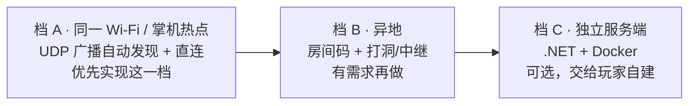

# 001 · 项目形态与联机方案

- 日期：2026-10-25
- 状态：已定

---

## D-01 游戏形态：单机为主 + 任务制 4 人房间

### 决策

- 核心循环 = RO 的养成/纸娃娃 + 早期 PSP《怪物猎人》的任务制狩猎。
- 绝大多数时间是单人游玩；多人只在「特定活动 / 副本 / 特定怪物」时成立。
- **单人在架构上实现为「1 人房间」**，与联机走完全相同的代码路径。
- 单个房间上限 4 人。

### 理由

- 任务副本是封闭空间、实体数量有限、生命周期短（20–40 分钟）。因此**不需要** AOI（兴趣管理）、分线、持久世界同步、经济防刷这些 MMO 级工程。
- 「单人 = 1 人房间」让单机与联机共用一套模拟层，不会出现「单机逻辑一套、联机逻辑另一套」的分裂。
- 开发者明确表示没有精力长期管理服务器。

### 被否决的方案

| 方案 | 否决原因 |
|---|---|
| 持久开放世界 MMO | 需要 AOI、分线、持久化、经济系统、反外挂，超出个人项目可维护范围 |
| 常驻主城多人同屏 | 成本最高、收益最低，且与单机定位冲突 |
| 账号 + 云存档 + 官方托管 | 需要长期运维与账单，与「没时间管服务器」直接矛盾 |

### 影响

- 所有玩法内容必须具备「可开房」与「可单人」两种进入方式。
- 任务之外的内容（养成、装备、看板、NPC 对话）默认单人。
- 未来新增的活动也必须是房间制，不能依赖在线服务下发。

---

## D-02 世界呈现：塞尔达式，联机时才有其他玩家

### 决策

- **不做**好友幻影、异步联机、共享世界事件、全服排行榜、主城人流。
- 单人世界里只有自己、NPC 与怪物。
- 只有在 4 人联机房间内才会出现其他玩家。
- 因此项目**不需要任何常驻在线后端**：无账号系统、无云存档、无排行榜服务。

### 理由

- 开发者明确表示可以接受《塞尔达传说》式的状态，不需要靠「有人的感觉」来支撑情绪价值。
- 砍掉在线后端后，唯一的网络需求只剩「联机时的房间同步」与「跨网络时的中继」。
- 长期成本归零：没有服务器账单、没有运维、没有账号合规问题。

### 影响

- 存档、进度、成就全部本地化，离线可完整体验。
- 跨网络联机若使用第三方中继（Unity Relay / EOS），只在联机瞬间消耗额度，不影响单机。
- 如果以后确实需要排行榜之类的在线功能，必须作为**可选增量**重新评估，不能反向污染核心架构。

---

## D-03 联机拓扑：房主即服务器

### 决策

采用「listen server」：**房主的掌机同时跑服务端与客户端**，其他玩家直连房主。

三档演进，按需推进：

| 档 | 适用场景 | 预估工作量 | 主要难点 |
|---|---|---|---|
| A | 同一路由器下，或房主开热点面对面联机 | 2–3 周 | 几乎无，体验最接近 MHP 的 Ad-Hoc |
| B | 各自在家 | +3–4 周 | NAT 穿透、中继延迟、免费额度 |
| C | 希望世界 24 小时在线 | +2 个月 | 运维问题重新出现，且玩家多为 Android 掌机，实际需求弱 |

补充说明：

- **档 A 不需要任何互联网服务**，也复刻了 PSP 怪物猎人的 Ad-Hoc 体验。房主开热点、其他人手动连入即可，零额外代码。
- 档 B 不自研 STUN/TURN，直接使用 Unity Relay 或 Epic Online Services 的免费额度。
- 档 C 明确**不做官方托管**，最多提供一个可自行部署的 .NET 服务端，与 Core 层共用同一份模拟代码。

### Android 掌机作为 host 的工程约束（必须提前设计）

| 问题 | 对策 |
|---|---|
| 系统会杀后台进程 | 使用 Foreground Service + 常驻通知，声明为游戏/网络用途 |
| Wi-Fi 省电休眠、Doze | 申请 `WifiLock`（`WIFI_MODE_FULL_HIGH_PERF`）并处理 Doze 白名单 |
| 锁屏即断线 | host 必须保持游戏在前台，允许调暗屏幕但不允许退出 |
| 发热与续航 | host 时降低渲染分辨率与帧率，把算力让给模拟层（见 D-08） |

这些是 Unity 侧的 Android 插件工作，不是纯 C# 能解决的，需要在阶段 0 就验证一次。

---

## D-04 存档：角色本地持有，世界状态在内存

### 决策

- **副本/世界状态**：只存在 host 的内存里，任务结束即丢弃，不做持久化。
- **角色存档**：由玩家本地持有；进入房间时把角色快照同步给 host 做基本校验。
- 任务结算的结果写回各自的本地角色存档。

### 理由

- 房主下线不会影响其他人的进度，客人也不会丢东西。
- 不需要服务端数据库，省掉一整套持久化与迁移问题。
- 代价是客户端可以改档作弊。对于朋友之间的合作 PvE，这个代价可以接受（参考暗黑破坏神 2 的开放战网）。

### 被否决的方案

- **服务器托管角色存档**：需要账号体系与数据库，违背 D-02。
- **世界持久化**：与任务制冲突，且需要 host 长期在线。

### 后续若要收紧

如果将来引入 PvP 或公开房间，再评估「由 host 托管房间内的角色快照 + 结算签名」，而不是恢复全服数据库。

---

## 待定

- 网络库最终选型（FishNet / Mirror / NGO），见 [002](002-技术栈与架构.md)
- 房间的发现方式细节（UDP 广播、二维码、房间码）
- 客人中途加入 / 掉线重连的规则
- 任务失败与房主退出的处理
