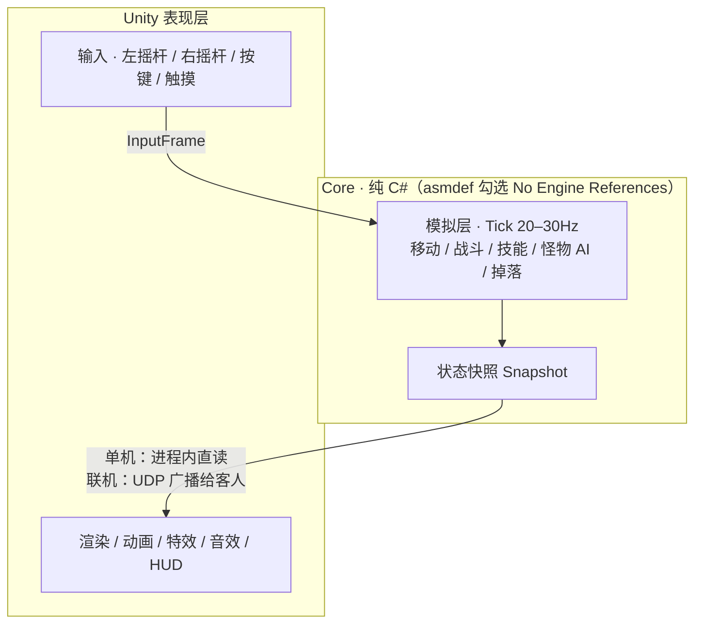

# 002 · 技术栈与架构

- 日期：2026-10-25
- 状态：已定（网络库选型待定）

---

## D-05 引擎：Unity 6 LTS + URP

### 决策

- Unity 6 LTS，渲染管线使用 **URP**。
- 语言：C#。
- 目标平台：Android（ARM64，IL2CPP）。

### 理由

| 维度 | 说明 |
|---|---|
| 学习成本 | 中文资料、教程、AI 训练数据量最大，遇到问题最容易搜到答案 |
| 美术管线 | 卡通着色方案成熟（UTS、自写 shader），FBX/glTF 导入顺畅，AI 生成的 3D 资产可直接使用 |
| 联机生态 | Mirror / FishNet / NGO 都有完整方案，LAN 发现、传输层、快照同步都有现成实现 |
| Android 导出 | 成熟的 IL2CPP + ARM64 + Vulkan/GLES3 路径，掌机适配资料多 |
| 移动端性能 | URP 移动端预设足够跑 1080p 低模卡通场景 |

### 被否决的方案

| 方案 | 否决原因 |
|---|---|
| Godot 4 | 开源轻量、shader 好写，但 3D 移动端坑更多、中文资料与 AI 训练数据少，对「不懂游戏开发」的起步阶段不友好 |
| Unreal 5 | 包体大、编译慢、移动端 3D 性能风险高，个人掌机项目过重 |
| Cocos Creator | 2D 强、3D 弱，不适合本项目的 3D 卡通路线 |

---

## D-06 架构：Core 模拟层 / Unity 表现层分离

这是整个项目**唯一一个「现在做错、以后改起来最贵」**的决策。

### 决策



- Core 层**禁止** `using UnityEngine`，用 Assembly Definition 的 **No Engine References** 强制约束。
- Core 只依赖 .NET 基础库，负责：实体、属性、技能、伤害、怪物 AI、掉落、任务状态、序列化。
- Unity 层只做三件事：把输入变成 `InputFrame`、把 `Snapshot` 变成画面、播放表现（动画/特效/音效）。
- 同一份 Core 代码同时跑在三个位置：单机进程内、host 掌机、客人端的预测副本。

### 理由

- 单机与联机共用一套逻辑，联机不是「再写一遍」。
- Core 可以编译成 .NET 控制台程序，将来上 Docker / 独立服务端零成本（对应 D-03 的档 C）。
- 对传统程序员来说，这就是熟悉的「后端逻辑 + 前端表现」结构。
- 可以直接对 Core 写单元测试，不需要启动 Unity。

### 被否决的方案

- **战斗逻辑写在 MonoBehaviour 里**（绝大多数 Unity 教程的做法）：联机时需要重写约 80% 的战斗代码，动画与逻辑纠缠无法测试。

### 建议的目录结构

```
Assets/
  Scripts/
    Core/            # 纯 C#，无 UnityEngine 引用
      Sim/           # Tick、实体、战斗、技能、AI、掉落
      Data/          # 配置表、存档结构
      Net/           # 消息定义、快照结构、序列化
    Game/            # Unity 表现层
      View/          # 渲染、动画、特效
      Input/         # Input System、手柄抽象
      UI/
  Settings/          # URP 配置、渲染参数
Server/              # 可选：.NET 独立服务端入口
```

---

## D-07 同步模型：状态同步 + host 权威 + 客户端预表现

### 决策

- 使用**状态同步**（host 周期性下发快照），**不做帧同步（lockstep）**。
- host 是唯一权威，所有伤害、掉落、怪物行为由 host 判定。
- 客人端采用「**表现先行、数值后到**」：
  - 攻击动画、特效、音效、伤害数字**本地立即播放**
  - 实际数值等 host 确认（约 1 个 RTT），不一致时静默校正
- 移动允许客户端预测 + 服务器校正；远程弹道允许客户端预测 + host 校验。

### 理由

- 帧同步要求所有客户端逻辑完全确定、对丢包零容忍，调试成本极高。
- 怪物猎人的怪物动作有 1–2 秒前摇，100ms 延迟玩家几乎无感，状态同步完全够用。
- 状态同步对丢包与延迟更宽容，实现也更简单。

### 待定

- 网络库：**FishNet / Mirror / NGO** 三选一
  - 倾向 FishNet（现代、性能好、支持 headless server）或 Mirror（成熟、中文资料多、自带 LAN 发现）
  - 需要先做一次小规模验证：host 掌机 + 2 个客人 + 20Hz 快照的稳定性
- Tick 频率：20Hz 起步，垂直切片时再测 30Hz 的收益
- 快照压缩方式（全量 vs 增量）
- 输入延迟补偿的具体参数

---

## D-08 目标平台与性能预算

### 设备

Ayn Odin 3：

- SoC：Snapdragon 8 Gen 2
- 屏幕：6 英寸 1080p（1920×1080）16:9 OLED
- 电池：约 8000mAh
- 系统：Android，完整手柄布局（双摇杆、十字键、ABXY、L1/R1/L2/R2）

### 分辨率策略

| 项目 | 决策 |
|---|---|
| UI 设计基准 | 1920×1080，按高度缩放 + Safe Area |
| 3D 渲染分辨率 | 1280×720 或 1600×900，放大到屏幕 |
| 帧率目标 | 60fps；host 模式下允许降到 30–40fps |
| 理由 | 卡通渲染 + 低模在 1080p 下差异很小，但发热与续航差异明显 |

### 画质预算（垂直切片阶段验证）

- 角色 3k–8k 三角面，同屏角色 ≤ 6
- 贴图 1024×1024 为主
- 描边用背面外扩（inverted hull），不用后处理
- 后处理只保留 bloom + 轻量色调映射
- 关闭实时阴影或只用低分辨率级联阴影，主要靠烘焙/AO 贴图

### 输入与操作映射

| 掌机输入 | 功能 |
|---|---|
| 左摇杆 | 移动（含死区、响应曲线） |
| 右摇杆 | 视角微调 / 目标切换 |
| A / B / X / Y | 攻击 / 闪避或交互 / 技能 / 技能 |
| L1 / R1 | 切换目标 / 防御或聚焦 |
| L2 / R2 | 技能页切换 / 蓄力 |
| 十字键 | 消耗品、道具快捷栏 |
| Start / Select | 菜单 / 地图 |
| 触摸屏 | 背包整理、商店、UI 操作 |

原则：

- 角色朝向可吸附 8 方向，保留原版的「方向感」，但移动是模拟量自由移动。
- 技能栏不照搬 RO 的 1–9 + 多页，改为「4 键 + 肩键组合」或长按呼出环形菜单。
- 所有 UI 元素排在拇指热区，不照搬 PC 的边角布局。

### Android 工程注意

- IL2CPP + ARM64，只出 ARM64 包
- 图形 API：Vulkan 优先，GLES3 兜底
- host 模式需要 Foreground Service、WifiLock 与前台保持（见 D-03）

---

## 阶段 0 验收标准（技术验证）

一句话：**在 Odin 3 上用摇杆控制一个小人，跑在 720p 60fps 的地图上，UI 不越界，能开一个 2 人房间。**

拆解为可勾选的项：

- [ ] Unity 6 + URP 空工程能出 ARM64 APK 并在掌机上运行
- [ ] 摇杆移动 + 按键输入在掌机上无延迟感
- [ ] 1920×1080 的 UI 在掌机上不越界、不遮挡
- [ ] 渲染分辨率降到 720p 放大后观感可接受
- [ ] 一个占位角色能跑、能转向、能播一个攻击动画
- [ ] 一张地砖地图，60fps 稳定
- [ ] Core 层 asmdef 编译通过，且确实无法 `using UnityEngine`
- [ ] 两台设备能在同一 Wi-Fi 下建立房间（哪怕只是同步一个位置）
- [ ] host 掌机能保持前台 10 分钟不掉线
