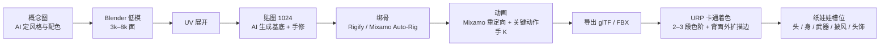

# 003 · 美术与角色管线

- 日期：2026-10-25
- 状态：已定（视觉锚点参数待定）

---

## D-09 角色路线：低模 3D + 卡通着色

### 决策

- 角色使用**低模 3D 模型**，卡通着色（cel / toon shading）渲染，不使用 2D 精灵或 2D 骨骼。
- 骨骼使用 Humanoid 规范，动画主要来自 Mixamo 重定向，关键动作手工调整。
- 纸娃娃采用槽位制：头 / 身 / 武器 / 披风 / 头饰。

### 关键认知：RO 的角色本来就是 3D 做的

RO 的角色资源（`.spr` + `.act`）是**用 3D 模型渲染成 2D 精灵**再切帧的，8 方向、每动作若干帧，全部预渲染。所以「用 3D 替代 2D」不是妥协，而是回到它原本的生产方式。

而且在 3D 下，纸娃娃从「拼图层 + 对帧对齐」变成「换 mesh + 换材质」，成本低一个数量级。

### 被否决的方案

| 方案 | 否决原因 |
|---|---|
| 3D 预渲染成 8 方向 2.5D 精灵 | 最还原原版质感，但每个角色要渲 8×N 帧，换装需重渲，管线最重 |
| 2D 骨骼动画（Spine / DragonBones） | 需要自己绘制分层部件，对不会画画的人是最大障碍 |
| 纯 AI 生成序列帧 | 多帧一致性无法保证，且无法换装 |

---

## D-10 美术生产：AI 负责平面，Blender 负责立体

### 决策

AI 承担**平面资产**，Blender 承担**模型与绑定**，Mixamo 承担**动作**。

| 环节 | 负责方 | 可信度 |
|---|---|---|
| 概念图、配色、风格锚定 | AI（SD / Flux） | 高 |
| 贴图、材质（tileable） | AI 生成基底 + 手工修 | 中高 |
| UI 图标、物品图标、头像 | AI + 抠图 | 高 |
| 场景概念、天空盒 | AI | 高 |
| 图生 3D 道具（宝箱、椅子） | Meshy / Tripo / Hunyuan3D | 中，拓扑需重做 |
| 角色模型 | Blender 低模 | — （AI 生成拓扑不可绑定，只能当参考） |
| 骨骼绑定 | Rigify / Mixamo Auto-Rig | — |
| 动画 | Mixamo 重定向 + 手 K 关键动作 | — |
| 多帧一致性序列动画 | — | 低，不做 |

结论：**AI 做平面资产，Mixamo 做动作，Blender 把两者接起来。** 需要学的是 Blender 的建模 / 绑骨 / 导出这条窄路径（约 2–3 周能做出第一只可动的怪），而不是学画画。

### 生产管线

### 资产规格（垂直切片阶段）

| 项目 | 规格 |
|---|---|
| 三角面 | 角色 3k–8k，怪物 5k–15k，道具 < 1k |
| 贴图 | 1024×1024，色块为主，不画细节 |
| 骨骼 | 30–50 根，蒙皮权重每顶点 1–2 根 |
| 动画 | 全部基于共享 Humanoid 骨架，动作可跨角色复用 |
| 相机 | 固定 45° 斜俯视，可小幅旋转 |

关键技巧（决定「像不像 RO」的四件事）：

1. **剪影优先**：Q 版 3 头身，头大、腿短、手脚夸张
2. **大色块**：高饱和、少渐变，靠色相区分部件
3. **描边**：背面外扩，粗细随距离微调
4. **2–3 段色阶**：明暗过渡硬切，不做写实高光

因为相机固定在 45° 俯视，角色**头顶与肩背的造型比脸重要**，这也是 AI 生成贴图够用的原因。

---

## D-11 法律边界：资产必须原创

### 决策

- 可以借鉴机制（纸娃娃、转职、技能树、任务制狩猎）。
- **禁止**使用 RO 的任何美术、音频、UI 贴图、地图、怪物造型。
- 避免使用 RO 的专有名词（职业名、地名、怪物名），改用原创命名。
- AI 生成资产时，提示词避免直接指向 RO 的具体角色或怪物。

### 理由

机制不受版权保护，具体表达受保护。用 RO 的 spr/act/bgm 属于明确的侵权，且在 Google Play 上会被下架。做一个原创的「Q 版幻想 MMORPG」完全合法。

---

## 待定

- 视觉锚点参数：头身比、主色板、色阶阈值、描边粗细
- 项目整体的色彩基调（明亮饱和 vs 低饱和做旧）
- 是否需要昼夜/天气（影响光照与烘焙方案）
- 特效风格：面片序列帧 vs 粒子系统
- 角色创建：是否允许捏脸/换色（影响纸娃娃槽位设计）
